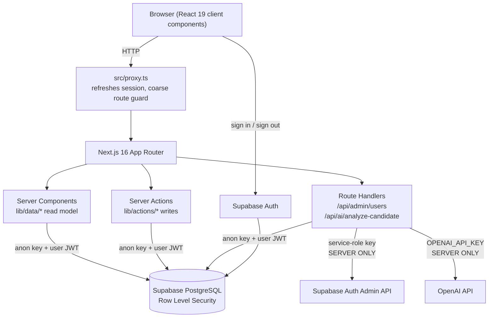
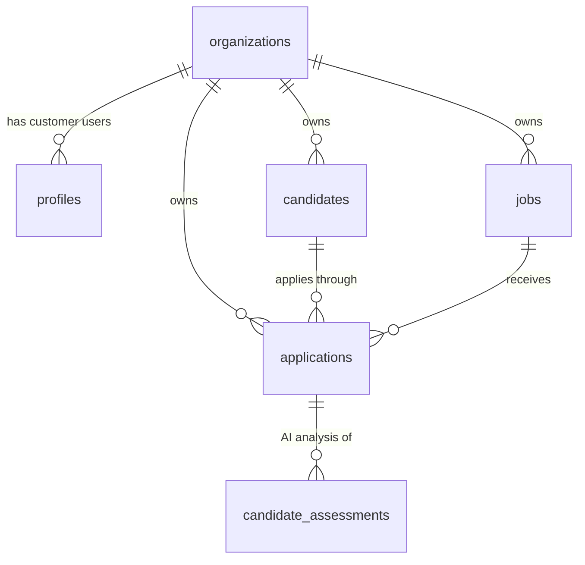

# TalentFlow

A mini applicant tracking system (ATS) for small recruitment teams. A platform
admin onboards customer organizations; each customer manages their own jobs,
their own talent pool, and a compact Kanban pipeline — and cannot see anyone
else's. An optional AI Match Analysis compares a candidate's CV against one
specific job and hands the recruiter decision support, never a decision.

Built as a scoped MVP: the customer journey works end to end, tenant isolation
is enforced by the database rather than by the UI, and the whole thing deploys
as one Next.js app plus one Supabase project.

## Live demo

- **App:** _to be filled in after deployment_
- **Admin credentials:** shared privately, never committed to this repository.
- **Demo data:** two fictional organizations — `Northstar Consulting AB` (the
  showcase tenant, three jobs and eight candidates spread across the pipeline)
  and `Lumen Health AB` (a second tenant that exists to demonstrate isolation).
  Every name, email, phone number and CV in the seed data is invented.

## Features

### Admin features

- Sign in as a platform admin (global, not attached to any organization).
- Create customer organizations.
- Create customer users, either into a new organization or an existing one.
- Create other platform admins.
- See every organization with its user, job, candidate and application counts.
- See every user on the platform, with role, organization and last sign-in.
- **Switch into any organization** and then do everything a customer can do on
  their behalf: create and edit jobs, add and edit candidates, assign candidates
  to jobs, move them through the pipeline, run AI Match Analysis. The active
  organization is always visible in the top bar.

### Customer features

- Sign in and land on a dashboard scoped to their own organization.
- Create, edit, open/close/draft and delete jobs, with the number of candidates
  per job.
- Add, edit, search and delete candidates, with email, phone, clickable
  LinkedIn URL, location and CV text.
- Assign a candidate to one or more jobs. Each assignment is an application.
- See every application on a compact Kanban board, filter by job, search by
  candidate name, and move candidates between stages.
- Run AI Match Analysis per application (when configured).

### Recruitment pipeline

Six stages: **New → Screening → Interview → Offer → Hired**, plus **Rejected**.

Rejected is kept off the board by default — a checkbox reveals it — so the board
stays readable.

Two ways to move a candidate, and they share one code path to the server:

1. **A stage dropdown**, on every Kanban card and on both detail pages. This was
   built first and is the reliable path: it works with a keyboard, on touch, and
   without a pointer.
2. **Drag-and-drop** (dnd-kit) between columns, layered on top afterwards.

Both are optimistic and both roll back with an error message if Postgres
rejects the change.

Filters are applied in the browser over the organization's already
tenant-scoped applications, which is what makes the job filter and the
case-insensitive name search feel instant. The candidate **list** page searches
server-side instead, via a `?q=` URL parameter answered by an indexed `ilike`,
so it stays correct as the talent pool grows.

### AI Match Analysis

Compares one candidate's CV and profile against one specific job and returns:

```json
{
  "match_score": 0,
  "summary": "...",
  "strengths": ["..."],
  "gaps": ["..."],
  "suggested_interview_questions": ["..."]
}
```

Guardrails, by design:

- **Decision support only.** The prompt forbids a hire/reject recommendation.
  The panel always shows: _"AI-generated decision support. Final hiring
  decisions should be made by a human."_ Nothing in the app changes a stage
  based on a model output.
- **Job-relevant evidence only.** The prompt explicitly rules out inferring,
  mentioning or scoring gender, ethnicity, race, nationality, religion, age,
  health or disability, sexual orientation, pregnancy, or family/marital status,
  and tells the model to ignore names and dates of birth as signals. The
  response schema has no field that could carry such a trait.
- **Nothing sensitive reaches the browser.** The client POSTs only an
  application id. The job description, the CV text, the prompt and the API key
  all stay on the server.
- **Structured output, then validated anyway.** The response is constrained by a
  JSON schema at generation time (`strict: true`) and then re-parsed with Zod,
  so a malformed answer becomes a clean error instead of broken UI.
- **Graceful when unconfigured.** With no `OPENAI_API_KEY`, the panel says
  _"AI Match Analysis is not configured in this environment."_ and every other
  feature works normally. No fallback is faked.
- Results are stored in `candidate_assessments` (under the same RLS rules) so
  the last run is visible on page load and a demo does not pay for a model call
  per refresh.

## Tech stack

| Layer | Choice |
| --- | --- |
| Framework | Next.js 16 (App Router), React 19, TypeScript (strict) |
| Styling | Tailwind CSS 4 |
| Icons | lucide-react, plus one inline SVG for the LinkedIn mark |
| Auth | Supabase Auth (email + password) |
| Database | Supabase PostgreSQL with Row Level Security |
| Validation | Zod 4, on every write path |
| Drag & drop | dnd-kit |
| AI | OpenAI Chat Completions with a strict JSON schema, server-side only |
| Tests | Vitest |
| Hosting | Vercel |

No state-management library, no ORM, no component library, no toast library —
server actions plus `useActionState` cover the mutations, and the few UI
primitives the app needs are about 400 lines in `src/components/ui/`.

## Architecture



The important property: **application code runs under the caller's own
identity.** Server Components, server actions and route handlers all use the
anon key plus the session cookie, so they are still subject to RLS. A bug in a
query cannot leak another tenant's rows. The service-role key, which bypasses
RLS, is used in exactly one place in the app (`POST /api/admin/users`) and in
the CLI scripts.

### Project structure

```
src/
  app/
    login/                      only unauthenticated page (+ login server action)
    (app)/                      authenticated route group, guarded by its layout
      dashboard/ jobs/ candidates/ pipeline/
      admin/organizations/ admin/users/
      actions.ts                organization switching
      error.tsx not-found.tsx loading.tsx (per route)
    api/
      admin/users/              create admin + customer accounts (service role)
      ai/analyze-candidate/     AI Match Analysis
  components/
    layout/ dashboard/ jobs/ candidates/ applications/ pipeline/ admin/ ui/
  lib/
    env.ts env.server.ts        public config vs. server-only secrets
    supabase/ client.ts server.ts admin.ts
    auth/session.ts             who is signed in
    permissions/access.ts       pure, unit-tested authorization helpers
    permissions/workspace.ts    who + which organization, per request
    data/                       read model (tenant-scoped queries)
    actions/                    write model (server actions)
    pipeline/filter.ts          pure, unit-tested board filtering
    validation/schemas.ts       every Zod schema in the app
    ai/analyze.ts               prompt, JSON schema, Zod validation
  types/                        database.ts, ai.ts
  proxy.ts                      session refresh + route guard (was middleware.ts)
supabase/
  migrations/                   source of truth for the schema
  schema.sql                    generated bundle, for one-paste setup
scripts/
  create-admin.ts seed.ts verify-isolation.ts build-schema.mjs
tests/                          validation, permissions, pipeline filtering
```

## Database model



| Table | What it is |
| --- | --- |
| `organizations` | One tenant — a customer company. Name is unique case-insensitively. |
| `profiles` | One row per `auth.users` row. Holds `full_name` and `role` (`admin` or `customer`), plus `organization_id`. A check constraint enforces that a customer *has* an organization and an admin does *not*. |
| `jobs` | A role being recruited for. `status` ∈ `draft`/`open`/`closed`. |
| `candidates` | A person in the organization's talent pool: name, email, phone, LinkedIn URL, location, CV text. |
| `applications` | **The candidate ↔ job relationship**, carrying the current `stage` and optional `notes`. Unique on `(candidate_id, job_id)`. |
| `candidate_assessments` | A stored AI Match Analysis for one application: score, summary, and `strengths`/`gaps`/`interview_questions` as JSONB. |

### Why `applications` exists

A candidate can be considered for several jobs at the same time, and the *same
person* can be at `interview` on one job and `rejected` on another. A `job_id`
column on `candidates` could not express that, and would force duplicating a
person once per job — which breaks search, deduplication and the talent pool
idea entirely. The demo data uses this deliberately: Johan Nilsson is in two
pipelines at once.

### Constraints and indexes worth noting

- `applications` references its parents through **composite foreign keys** on
  `(organization_id, candidate_id)` and `(organization_id, job_id)`, backed by
  `unique (organization_id, id)` on `candidates` and `jobs`. A cross-tenant
  application is therefore rejected by the database, not just by a policy.
- `candidates (organization_id, lower(full_name))` backs the case-insensitive
  name search.
- `jobs (organization_id, status)` and `applications (organization_id, stage)`
  back the dashboard counters and the board.
- `updated_at` is maintained by a `BEFORE UPDATE` trigger, so it cannot be
  faked by a client.
- Stage and status values are constrained in the database *and* in Zod. The Zod
  layer means the database constraint should be unreachable — it is the backstop,
  not the error message.

## Authentication

- Supabase Auth, email + password. **No public signup**; `/login` is the only
  unauthenticated route.
- Sign-in runs as a **server action**, so session cookies are written HttpOnly
  by the server rather than being handled in client JavaScript.
- Session resolution uses **`auth.getUser()`**, which revalidates the JWT with
  Supabase, not `auth.getSession()`, which only decodes the cookie. A forged or
  expired cookie cannot produce a signed-in session.
- `src/proxy.ts` refreshes the access token on every request (Server Components
  cannot write cookies, so something upstream has to) and bounces anonymous
  visitors to `/login` with a `?next=` return path.
- The `(app)` route group's layout re-checks the session, so a page that forgot
  its own guard is still unreachable anonymously. Admin pages additionally call
  `requireAdminContext()`.
- Login errors are deliberately generic ("Incorrect email or password") so the
  form cannot be used to enumerate which emails have accounts.
- The `?next=` redirect only accepts paths starting with a single `/`, so it
  cannot be used as an open redirect.

## Multi-tenancy and RLS

**The frontend never enforces tenancy.** It is enforced in PostgreSQL.

Three `SECURITY DEFINER` helper functions read the caller's profile:

```sql
tf_role()      -- 'admin' | 'customer'
tf_org_id()    -- the caller's organization_id, or NULL for an admin
tf_is_admin()  -- boolean
```

They are `SECURITY DEFINER` because a policy *on* `profiles` that reads
`profiles` would otherwise recurse.

Every business table then carries the same four policies, all scoped
`to authenticated`:

```sql
for select using      (tf_is_admin() or organization_id = tf_org_id())
for insert with check (tf_is_admin() or organization_id = tf_org_id())
for update using      (...) with check (...)
for delete using      (tf_is_admin() or organization_id = tf_org_id())
```

What each part buys:

- **`to authenticated`** — the `anon` role has no policy on any table, so an
  unauthenticated PostgREST request returns nothing. It does not depend on the
  app blocking it.
- **`USING` on SELECT** — another tenant's rows do not exist as far as the
  caller is concerned. A lookup by primary key returns zero rows, which is why
  a foreign id produces a 404 rather than a 403 (and leaks nothing).
- **`WITH CHECK` on INSERT/UPDATE** — this is the anti-spoofing control.
  `organization_id` is a writable column, so without `WITH CHECK` a customer
  with a valid session could insert a row stamped with another tenant's id.
- **`tf_is_admin()`** — platform admins pass every policy, which is what lets
  them operate on a customer's behalf without a separate code path.

Defence in depth on top of that:

1. Every query in `lib/data/` also filters on `organization_id` explicitly —
   correctness and query planning, not security.
2. Every write resolves the organization **server-side** from the session
   (`lib/actions/context.ts`). The client cannot supply an `organization_id`.
3. An admin's active-organization cookie is re-validated every request and
   ignored entirely for customers (`resolveActiveOrganizationId`, unit-tested).
4. Composite foreign keys make a cross-tenant application physically impossible.
5. `lib/env.server.ts` and `lib/supabase/admin.ts` both import `"server-only"`,
   so the build fails if a secret or the service-role client is ever pulled into
   a client component.

### Verifying it, rather than asserting it

```bash
npm run verify-isolation -- --password "<demo customer password>"
```

This signs in as a seeded customer from each organization **with the anon key —
exactly what the browser uses** — and then, as that user, attempts to:

- read the other tenant's jobs, candidates and applications → expects 0 rows;
- read one of the other tenant's jobs **by primary key, with no organization
  filter** → expects 0 rows (this is the check that proves the filtering is not
  coming from our own `WHERE` clause);
- read the other tenant's `organizations` row → expects 0 rows;
- `INSERT` a job stamped with the other tenant's `organization_id` → expects
  the write to be denied;
- `UPDATE` one of their jobs by id → expects 0 rows affected;
- `DELETE` one of their candidates by id → expects 0 rows affected;
- read its *own* jobs → expects rows, so the suite cannot pass by denying
  everything.

With `--admin-email`/`--admin-password` it also confirms a platform admin does
see both tenants. The script exits non-zero if any check fails.

## Local development

```bash
git clone <repository-url>
cd talentflow-ats
npm install
cp .env.example .env.local      # then fill it in - see below
npm run dev                     # http://localhost:3000
```

Other commands:

```bash
npm run lint         # ESLint (Next 16 core-web-vitals + TypeScript)
npm run typecheck    # next typegen && tsc --noEmit
npm test             # Vitest
npm run build        # production build
npm run db:schema    # regenerate supabase/schema.sql from the migrations
```

## Environment variables

| Variable | Where it runs | Required | Purpose |
| --- | --- | --- | --- |
| `NEXT_PUBLIC_SUPABASE_URL` | browser + server | yes | Supabase project URL |
| `NEXT_PUBLIC_SUPABASE_ANON_KEY` | browser + server | yes | Public key; every query it makes is still filtered by RLS |
| `SUPABASE_SERVICE_ROLE_KEY` | **server only** | yes | Bypasses RLS, used for the Auth Admin API in `/api/admin/users` and by the scripts |
| `OPENAI_API_KEY` | **server only** | no | Enables AI Match Analysis. Omit it and the rest of the app works normally |
| `OPENAI_MODEL` | server only | no | Defaults to `gpt-4.1-mini` |

Only the two `NEXT_PUBLIC_` values ever reach the browser bundle. They are the
only things exported from `src/lib/env.ts`; the secrets live in
`src/lib/env.server.ts`, which imports `"server-only"` — so pulling a secret
into a client component is a **build error**, not a silent leak. `.gitignore`
ignores `.env*` and un-ignores only `.env.example`.

## Supabase setup

1. Create a project at [supabase.com](https://supabase.com).
2. **Settings → API** — copy the project URL, the anon/publishable key and the
   service-role key into `.env.local`.
3. **SQL Editor → New query** — paste the whole of
   [`supabase/schema.sql`](supabase/schema.sql) and run it. That file is
   generated from `supabase/migrations/*.sql` (the source of truth) by
   `npm run db:schema`, and every statement is idempotent, so re-running it is
   safe. With the Supabase CLI available you can apply the migrations directly
   instead.
4. Create your admin account:
   ```bash
   npm run create-admin -- --email you@example.com --name "Your Name"
   ```
   The generated password is printed once and is not written anywhere.
5. Load the demo data (optional, but it is what makes the Kanban demo useful):
   ```bash
   npm run seed
   ```
   This creates both demo organizations, their customer users, jobs, candidates
   and applications, and prints the credentials. It is idempotent.

Email confirmation is not used: accounts are created pre-confirmed because no
SMTP provider is configured, and the admin hands the password over directly.

## Build

```bash
npm install
npm run lint       # clean
npm run typecheck  # clean
npm test           # 53 tests passing
npm run build      # clean
```

## Deployment

Deployed to Vercel as a single Next.js app.

1. Push the repository to GitHub.
2. Import it in Vercel (framework preset: Next.js — no build settings needed).
3. Add the environment variables above as **Production** (and Preview) env vars.
   `SUPABASE_SERVICE_ROLE_KEY` and `OPENAI_API_KEY` must **not** be prefixed with
   `NEXT_PUBLIC_`; Vercel keeps them server-side.
4. Deploy, then check `/login`, `/dashboard`, `/jobs`, `/candidates` and
   `/pipeline` against the live Supabase project.

Supabase needs no allowlist for this app — all server-side calls come from
Vercel, and the browser only talks to Supabase Auth with the anon key.

## Trade-offs

Things I chose deliberately, and what I traded away:

- **Dropdown before drag-and-drop.** The stage dropdown was built, tested and
  shipped first; dnd-kit was added afterwards on the same server action. If the
  drag layer had broken, the product would still have worked.
- **In-memory joins over PostgREST embedding.** Two or three indexed bulk
  queries, joined in TypeScript, instead of embedded selects. Keeps the
  hand-written types honest and avoids ambiguity from the composite foreign
  keys. The cost is slightly more data over the wire; the first thing I would
  change at larger scale.
- **Hand-maintained database types.** The Supabase CLI was not available in the
  build environment, so `src/types/database.ts` is written by hand in the exact
  shape `supabase gen types typescript` produces. It can be swapped for
  generated output without touching a single call site.
- **Client-side board filtering.** Instant filtering at the cost of loading an
  organization's applications in one go. Fine for hundreds; at 100k it becomes
  server-side filtering with pagination.
- **CV as pasted text.** Reliable and immediate, versus PDF upload plus
  extraction, which is a sub-project. Documented as the next step.
- **One shared schema with RLS**, not a schema per tenant. One migration path
  and one connection pool, and isolation enforced by the database.
- **No soft deletes or audit log.** A delete is a delete. An audit log is the
  right next addition for a hiring tool, but it is not what makes the MVP
  usable.
- **No toast system.** Inline form-level success and error banners instead. Less
  code, fewer moving parts, and the feedback sits next to what caused it.
- **Dev-only npm advisories accepted.** The five high-severity advisories are
  all in the `eslint-config-next` dependency chain and ship nothing to
  production; the offered fix downgrades it to a version that does not support
  Next 16.

## Known limitations

- A candidate's stage history is not kept — only the current stage.
- No email invitations or password reset flow; an admin creates the account and
  passes the password on. Users cannot yet change their own password in-app.
- No per-user roles inside an organization. Every customer user in an
  organization sees the same data.
- Pipeline stages are fixed for all tenants.
- `listPlatformUsers` reads the first 1000 auth users in one page; beyond that
  the admin user list would need pagination.
- Admin account creation uses a compensating delete rather than a real
  transaction: Supabase Auth and the Postgres table cannot be committed
  atomically from the client side. If the profile insert fails, the auth user is
  deleted again; if *that* delete also failed, a sign-in-capable account with no
  role could be left behind (the app treats such a user as not signed in).
- No rate limiting on `/api/ai/analyze-candidate` beyond it requiring a session.
- Candidate deduplication is not implemented — the same person can be added
  twice under two email addresses.
- No pagination anywhere; lists load an organization's rows in full.
- The AI score is not calibrated or monitored. It is one model's opinion on one
  prompt, shown as such.

## Future improvements

In roughly the order I would do them:

1. **Audit log** of every stage change and record edit — the single most valuable
   addition for a hiring tool, and the foundation for compliance questions.
2. **CV PDF upload** via Supabase Storage with tenant-scoped access, plus server
   side text extraction into `cv_text`.
3. **Email invitation and password reset** flows, so admins stop handling
   passwords at all.
4. **Notes and comments** per application, with authorship, so the pipeline
   carries the conversation.
5. **Stage history** and basic funnel analytics (time-in-stage, conversion per
   stage) built on top of the audit log.
6. **Server-side search and pagination** everywhere, and full-text search
   (`tsvector`) across CV text.
7. **Candidate deduplication** on email and fuzzy name match at creation time.
8. **Configurable pipeline stages** per organization.
9. **Interview scheduling** and calendar integration.
10. **AI evaluation and monitoring**: log prompt/model versions, sample and
    human-score outputs, and watch score distributions across groups for
    disparate impact before anyone is allowed to rank on the score.
11. **Rate limiting and cost controls** on the AI endpoint.
12. **Playwright end-to-end smoke test** in CI, covering login → create job →
    add candidate → assign → move stage.
13. **Generated Supabase types** and `supabase db push` in CI once the CLI is
    part of the toolchain.

## AI-assisted development

This was built with heavy AI assistance, which the assignment explicitly
encouraged. Being concrete about what that means:

**Claude Code (Opus 5) was used for** project scaffolding, writing the SQL
schema and the RLS policies, the Next.js pages and components, the server
actions, the AI integration, the test suite, the setup scripts and this
documentation. It also did the debugging: the `lucide-react` v1 brand-icon
removal, the four `react-hooks/set-state-in-effect` violations, the Vitest
ESM config failure, and two genuine bugs in the drag-and-drop board (a
duplicated `setNodeRef`, and a stage change firing the server action twice).

**What I did not do** is accept output without running it. Every claim in this
README is backed by something that was executed: `npm run lint`,
`npm run typecheck`, `npm test` and `npm run build` all pass, the Next.js 16
conventions were checked against the bundled docs in `node_modules/next/dist/docs/`
rather than assumed, and tenant isolation is proven by a script that signs in as
real users and tries to cross the boundary — not by reading the policy file and
trusting it.

`PROJECT_LOG.md` records what actually went wrong and how it was fixed, including
the bug the tests caught in `emailSchema` and the test assertion that turned out
to be wrong rather than the code. That log is the honest version of this build.
